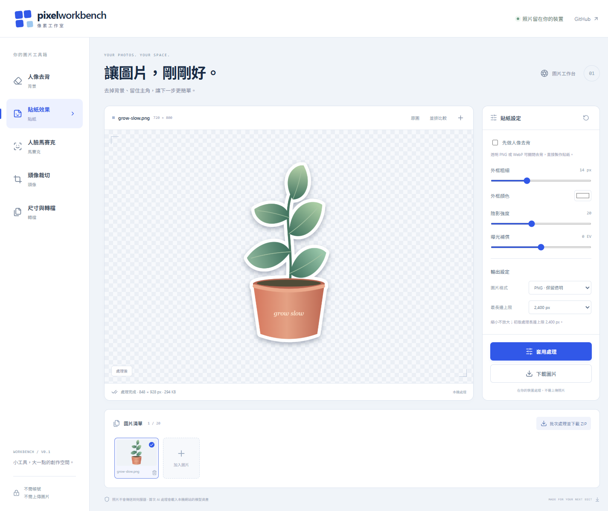

# Pixel Workbench

在瀏覽器處理圖片的小型工作台。照片留在裝置，使用 React、TypeScript、Canvas 與 MediaPipe；不需要帳號、API key 或圖片處理後端。

正式網站：[pixel-workbench-eta.vercel.app](https://pixel-workbench-eta.vercel.app)



## 功能

| 工具       | 已實作                                                   |
| ---------- | -------------------------------------------------------- |
| 人像去背   | 透明背景、自訂底色、背景虛化。                           |
| 貼紙效果   | 人像去背或沿用透明 PNG／WebP，調整外框顏色、粗細與陰影。 |
| 人臉馬賽克 | 自動偵測近距離人臉並像素化，可調整馬賽克大小。           |
| 頭像裁切   | 依最大人臉置中，提供 1:1、4:5、3:4。                     |
| 裁切與旋轉 | 1:1、4:5、3:4、16:9、9:16，裁切位置、90°／180°／270° 旋轉、水平與垂直翻轉。 |
| 色彩與銳化 | 對比度、飽和度、黑白照片與邊緣銳化；保留透明度。 |
| 文字浮水印 | 自訂文字、五種位置、顏色、大小與不透明度，文字過長自動縮小。 |
| 尺寸與轉檔 | PNG、JPEG、WebP，調整品質、最長邊與曝光補償。            |
| 批次處理   | 最多 20 張使用相同設定，依序處理並下載 ZIP；可取消處理。 |

支援拖放、選檔與 Ctrl／⌘ + V 貼上圖片，提供原圖檢視、並排比較、單張下載與內建貼紙範例。調整設定後按「套用處理」，確認預覽再下載；變更設定後需重新處理，才可下載或接續編輯。

### 接續使用多個工具

1. 加入圖片，選擇工具並按「套用處理」。
2. 按「接續編輯」，結果會成為清單中的新圖片，原始圖片仍保留。
3. 選擇下一個工具再處理，例如：去背 → 裁切 → 調色 → 浮水印。

每個工具以目前選取的圖片為輸入。接續編輯會重設參數，避免曝光、旋轉或浮水印重複套用；已完成的效果保留在新圖片中。重複處理建議使用 PNG，避免 JPEG／有損 WebP 再編碼損失。

批次按鈕會用當下設定重新處理清單內的**每張圖片**，包含原圖及接續編輯產生的版本；可先移除不需輸出的版本。裁切、調色、銳化、浮水印與轉檔不需模型。

## 本機啟動

建議使用 **Node.js 24 LTS、npm 11**，以及最新版 Chrome、Edge 或 Firefox。程式需 `Worker`、`createImageBitmap`、`OffscreenCanvas` 與 WebAssembly；瀏覽器支援仍以實測為準。

```sh
git clone https://github.com/ntustRay/pixel-workbench.git
cd pixel-workbench
npm ci
npm run dev
```

Repo 為私有，clone 需要 GitHub 存取權。開啟 Vite 顯示的本機網址，不要直接以 `file://` 開啟 HTML。

`npm ci` 的 `postinstall` 會從固定的 `@mediapipe/tasks-vision@0.10.32` 準備兩種 WASM，並從 Google 官方來源下載兩個版本固定的模型；模型必須通過 SHA-256 驗證才會安裝。首次安裝需要網路；資產出錯可執行 `npm run assets:prepare` 重試，不需任何憑證。瀏覽器執行時從本站載入資產，只有使用 AI 工具時才載入相應模型；轉檔及沿用透明度的貼紙不用模型。

## 建置與檢查

```sh
npm run typecheck
npm test
npm run build
npx playwright install chromium
npm run test:e2e
npm run preview
```

`build` 產生 `dist/`，可交給支援靜態檔案的 HTTPS 主機。請完整包含模型、WASM 與授權資訊；模型和 WASM 不應被 SPA fallback 回傳成 HTML。純運算測試與瀏覽器測試分開，測試內容見 `src/core/*.test.ts`、`tests/`。

Playwright 預設使用下載的 Chromium；可用 `PLAYWRIGHT_CHANNEL=chrome` 選用本機 Chrome。`TEST_PRODUCTION=1` 會針對 build 後的 preview 執行操作與真模型測試；GitHub Actions 會驗證開發及 production 兩種環境。真模型測試需下載 Google 官方公開測試人像，不會將你的照片納入測試或 repo。

## Vercel 部署

`vercel.json` 固定使用 Vite、`npm ci`、`npm run build` 與 `dist/`。Vercel 建置時會執行 `postinstall`，下載並驗證模型，模型與 WASM 都包含在靜態部署內，不需要 Functions、環境變數或 API key。

`package.json` 固定 Node.js 24.x，讓 Vercel 與 GitHub Actions 使用相同的主要版本。

Git 整合以 `main` 作正式分支，其餘分支可產生 Preview。GitHub Actions 保留作程式碼、瀏覽器及正式 build 的驗證；Vercel 的自動部署與這組檢查各自執行。

模型及 WASM 使用穩定檔名，設定為重新驗證快取，避免升級後仍使用舊版引擎；WASM 明確使用 `application/wasm`。此專案沒有前端路由，不需要將所有路徑改寫成 `index.html`。

指定 `E2E_BASE_URL` 可直接驗證線上網站，不啟動本機伺服器；執行相同的下載、手機版與真模型測試，並檢查瀏覽器請求是否維持同源。

## 限制

- 輸入接受 JPG、PNG、WebP；最多 20 張，每張 30 MB、4,000 萬像素。初版處理長邊最多 2,400 px，只縮小、不放大。
- 去背模型適合人像，不是通用商品去背。商品貼紙請提供已去背的透明 PNG／WebP，並關閉「先做人像去背」。
- 人臉偵測可能漏掉小臉、側臉、遠距或遮擋；馬賽克結果須逐一檢查，不能保證完整隱私遮蔽。未偵測到臉時，頭像保留原圖比例並顯示提醒。
- JPEG 不支援透明度，輸出會填白底；保留透明度請選 PNG 或 WebP。曝光補償是亮度調整；銳化是邊緣對比運算，可能放大雜訊，兩者都不會還原失焦或壓縮遺失的細節。
- 裁切先旋轉與翻轉，再依比例和位置取出範圍；不是自由框選。浮水印支援單行最多 80 個字，大小依輸出短邊計算；字體使用裝置可用的字體。
- 批次依序處理以控制記憶體，但 ZIP 仍在記憶體組成；取消會終止 Worker，下一次使用 AI 工具會重新初始化。
- 照片不需上傳，不代表首次安裝離線、零網路請求或所有第三方版本均無遙測。MediaPipe 的版本與隱私來源見[第三方說明](THIRD_PARTY_NOTICES.md)。

## 擴充

UI 不直接操作模型。共同處理入口負責驗證、效果、尺寸、曝光與編碼；新工具可加入 registry，模型可透過 `AnalysisProvider` 替換，單張和批次共用相同流程。

詳見[架構與擴充方式](docs/architecture.md)、[模型選擇與 roadmap](docs/model-decisions.md)、[第三方授權](THIRD_PARTY_NOTICES.md)。DnCNN 去噪、TEED 線稿、YuNet adapter、通用商品去背與藝術風格尚未整合，不會顯示無法使用的功能入口。
