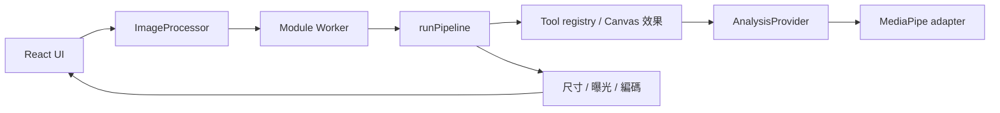

# 架構與擴充方式

以同一條圖片處理流程支援單張預覽與批次輸出。UI、圖片效果、模型 adapter 分開；不用為每個功能重建上傳、下載或 Worker 管理。

## 三層責任

| 層             | 檔案                                                              | 負責內容                                                                                                                             |
| -------------- | ----------------------------------------------------------------- | ------------------------------------------------------------------------------------------------------------------------------------ |
| 操作與工作管理 | `src/ui/`、`src/core/client.ts`、`files.ts`                       | 匯入驗證、原圖與結果預覽、設定、進度、單張下載、批次 ZIP、取消、Object URL 清理。`ImageProcessor` 管理 Worker 生命週期及 90 秒逾時。 |
| 圖片處理       | `src/core/pipeline.ts`、`catalog.ts`、`types.ts`、`src/features/` | 共用參數驗證、工具選擇、Canvas 效果、尺寸／曝光與輸出編碼。`catalog.ts` 只放 UI 資訊，實作留在 pipeline 的 `processors` registry。   |
| 影像分析       | `src/inference/mediapipe.ts`                                      | 實作 `AnalysisProvider`，將模型回傳轉成 `PortraitMask` 或 `FaceBox[]`，隱藏初始化、下載位置及推論細節。                              |

`src/workers/image.worker.ts` 是連接工作管理與處理的薄層：依序執行任務、回報進度／錯誤、關閉轉移進來的 `ImageBitmap`。UI 只匯入型別與工具資訊，不匯入推論實作。

## 一張圖片的流程

1. `readSource()` 驗證格式、檔案大小與像素數，保留原始 `File`；建立供預覽使用的 Object URL。
2. `ImageProcessor.process()` 將圖片解碼成最多長邊 2,400 px 的 `ImageBitmap`，以 transferable 交給 Worker。
3. `runPipeline()` 驗證設定、呼叫選定工具。Worker 只快取目前這張圖片與尺寸的人像遮罩／人臉框，換效果可沿用，換圖即釋放；單次 pipeline 也以 Promise 避免重複推論。
4. 工具輸出 `OffscreenCanvas`；pipeline 再統一縮圖、曝光與編碼。JPEG 透明區填白；瀏覽器不能提供要求的編碼格式時回報錯誤。
5. UI 用新的結果 Blob 建立預覽；只有結果仍對應目前圖片和設定時才能下載。批次沿用同一處理入口、設定快照與取消訊號，逐張把結果加入 ZIP。

## 模型與 Worker 生命週期

- `AnalysisProvider` 懶載入 `@mediapipe/tasks-vision`；第一次使用相應能力才初始化分割或人臉模型。兩種 task 共用套件與同源 runtime 檔案快取，各自仍有 WASM task instance 和記憶體。
- 模型初始化依序執行；失敗會清除該模型的 Promise，讓下次操作能重試。Worker 內的任務也依序執行，避免模型和 Canvas 重入。
- 取消、逾時或 Worker 錯誤會 terminate Worker、拒絕待完成任務並增加 generation；較早開始的解碼結果不能回到新工作。下次操作建立新的 Worker。
- 目前採 CPU delegate；沒有將 WebGPU 成效或特定手機速度當作已驗證承諾。

## 可重現的靜態資產

`scripts/prepare-assets.mjs` 在 `postinstall` 執行，將套件 WASM 準備到 `public/wasm/`，下載版本固定的兩個官方模型到 `public/models/`。已有正確雜湊的模型直接重用；新下載先驗證再替換，不接受上游內容悄悄改變。

| 模型                                     | 實測檔案大小  | SHA-256                                                            |
| ---------------------------------------- | ------------- | ------------------------------------------------------------------ |
| `selfie_segmenter.tflite`，FP16／1       | 249,537 bytes | `191ac9529ae506ee0beefa6b2c945a172dab9d07d1e802a290a4e4038226658b` |
| `blaze_face_short_range.tflite`，FP16／1 | 229,746 bytes | `b4578f35940bf5a1a655214a1cce5cab13eba73c1297cd78e1a04c2380b0152f` |

MediaPipe `0.10.32` 預設 loader 使用 classic script 的載入方式，與 module Worker 不直接相容。準備腳本保留官方 loader 原文，提供 strict mode 所需的 module logger 並附加 ESM default export；adapter 以自訂 `WasmFileset` 提供 loader factory。這段 bridge 固定綁定版本，升級必須重驗 SIMD／非 SIMD 初始化、兩個模型與實際 production build，不只改 package 版本。

WASM 是主要載入成本：SIMD binary 約 11.45 MB，加 loader 約 205 KB；非 SIMD binary 約 10.65 MB。瀏覽器依能力載入其中一種，不能把兩個小模型的大小宣稱為整個 AI 功能的下載量。首次安裝仍需要網路。

## 新增工具或替換模型

1. 在 `types.ts` 增加 `ToolId` 與必要設定；只有出現真正新能力時才擴充 `AnalysisProvider` 的 interface。
2. 在 `features/` 實作工具，接受 `ImageBitmap`、設定及 provider，回傳 `OffscreenCanvas`。重用現有 Canvas／geometry helper。
3. 在 `pipeline.ts` 的 `processors` registry 註冊實作；`catalog.ts` 加入顯示資訊，並在 `Controls.tsx` 提供有效設定。UI 入口要等處理功能可用才加入。
4. 新模型實作 adapter，轉成既有的遮罩／人臉框資料；例如 YuNet 可替換 `faces()` 的內部實作，馬賽克與頭像工具不用知道 ONNX 輸出結構。
5. 將固定來源、SHA-256、授權與限制加入資產腳本和 notices；使用共用 pipeline 測試功能，再以真實模型做瀏覽器端到端驗證。

DnCNN、TEED 等需要新的影像修復能力時，先確認實際介面與驗證資料，再引入 runtime；不為 roadmap 預建空 adapter 或假按鈕。選型理由見[模型文件](model-decisions.md)。
